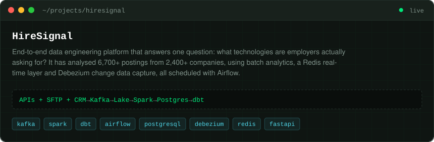
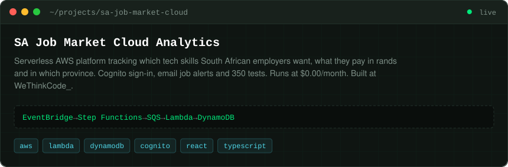
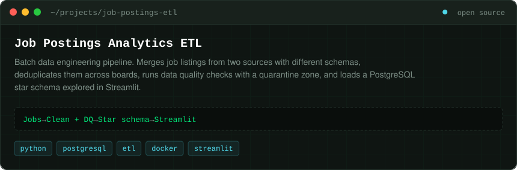

<a href="https://sbusiso-tech.github.io/"></a>

<div align="center">

[](https://sbusiso-tech.github.io/) [](https://www.linkedin.com/in/sbusiso-shinga-1605383ba) [](mailto:sibusisoshinga@gmail.com) 

</div>

## `$ cat about.md profile.js`

<table>
<tr>
<td width="55%" valign="top">

I build reliable products end to end, with a strong bias for maintainable systems and polished developer experience. My recent work spans **serverless apps on AWS** and **data pipelines** that turn raw job postings into clear answers about what employers are really looking for.

Before moving into development, I spent two years in IT support, so I care about systems that are easy to run, easy to fix and work for the people using them.

</td>
<td width="45%" valign="top">

```js
const profile = {
  location: "Johannesburg, ZA",
  role: "Software and Data Engineer",
  experience: "2 years IT support",
  education: [
    "WeThinkCode_ (in progress)",
    "ND: IT (DUT)",
  ],
  learning: ["Rust", "product strategy", "DX tooling"],
  languages: ["English", "isiZulu"],
  openToWork: true,
};
```

</td>
</tr>
</table>

## `$ git log --career`

```diff
@@ career.git @@
+ 9f3e7c2 (HEAD -> wethinkcode)  2025 – present  feat: Software Engineering Programme @ WeThinkCode_
+ e4c1a9f (techsoft)             2023 – 2024     feat: Technical Support @ Techsoft International
+ 1a0c3d8 (dut)                  2013 – 2017     init: ND Information Technology @ Durban University of Technology
```

## `$ ls -la projects/`

<a href="https://github.com/Sbusiso-tech/hiresignal"></a>
<p align="right"><a href="https://sbusiso-tech.github.io/hiresignal/">[live dashboard]</a> · <a href="https://github.com/Sbusiso-tech/hiresignal">[view code]</a></p>

<a href="https://github.com/Sbusiso-tech/sa-job-market-cloud-analytics"></a>
<p align="right"><a href="https://dzc3ibsjqeo54.cloudfront.net">[live app]</a> · <a href="https://github.com/Sbusiso-tech/sa-job-market-cloud-analytics">[view code]</a></p>

<a href="https://github.com/Sbusiso-tech/job-postings-etl"></a>
<p align="right"><a href="https://github.com/Sbusiso-tech/job-postings-etl">[view code]</a></p>

## `$ cat skills.yml`

<sub><code># languages</code></sub><br/>


<sub><code># data</code></sub><br/>
<br/>
<sub><code>+ spark · airflow · dbt · debezium · power bi · streamlit · pandas · sql</code></sub>

<sub><code># tools</code></sub><br/>


<sub><code># general</code></sub><br/>
`Agile/Scrum` · `data modelling (star schemas)` · `automated testing (pytest)` · `CI/CD` · `infrastructure as code` · `troubleshooting and technical support`

## `$ git stats`

<div align="center">


</div>

## `$ ./contact.sh`

```diff
+ status: open to work
```

I'm open to work and thoughtful collaboration. The best way to reach me is by **[email](mailto:sibusisoshinga@gmail.com)** or **[LinkedIn](https://www.linkedin.com/in/sbusiso-shinga-1605383ba)**.

<div align="center">
<sub><code>sbusiso@portfolio:~$ exit 0</code></sub>
</div>
